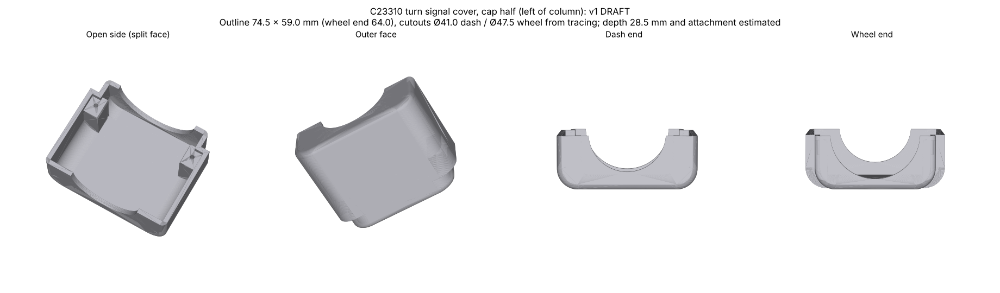
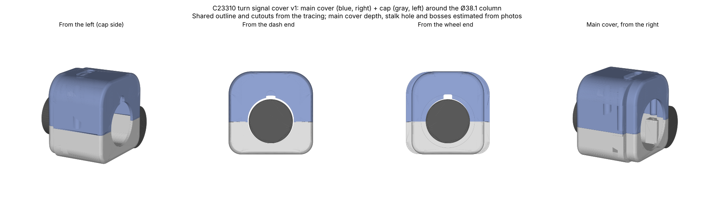

# Turn signal switch cover C23310 — 1959 Jaguar XK 150S (T831957DN)

The two-piece cover that clamps around the steering column over the turn signal (indicator) switch.

**Orientation on the car:** the two halves meet on a vertical split face that runs along the column. The larger, deeper half (the main cover) sits on the **right** of the column; the turn signal stalk comes out through the smaller hole in its side. The cap half, the subject of this design, closes the **left** side. Inside, a metal U-strap around the column is screwed to the main cover, so the cap does not clamp the column itself.

**This is a 3D part, not laser-cut sheet metal.** The design is for 3D printing.

## Original vs. reproduction

- **Original:** the main cover measured for this design is **die-cast zinc alloy**, painted black (cast mark "BS 1004 A", the British Standard for zinc die castings).
- **Reproduction:** SNG Barratt sells a complete two-piece reproduction in **black plastic**. Its photos (in `images/`, from an eBay listing) show a similar layout, but it **differs in detail** from the original. This design follows the original main cover; the listing photos are used only for general layout.

## Status

**v1 draft.** The split-face outline and both column cutouts come from a 1:1 tracing of an original main cover on millimeter grid paper (about ±0.5 mm). The depth, wall thickness, outer rounding and the attachment are still estimates. Not yet test-printed.

A model of the **main cover** is included for fit testing (see below). It shares the split-face outline, column cutouts and column position with the cap, so the two always match at the split face.

## v1 dimensions (millimeters)

Units are **millimeters**, as usual for 3D printing (25.4 mm = 1 in). X is across the column (vertical on the car), Y is along it from the dash end, Z = 0 is the split face.

| Feature | v1 value | Source |
|---|---|---|
| Split-face outline | 74.5 across × 59.0 along the column | Tracing |
| Wheel-end section | Narrows to 64.0 across for the last 9.5 mm (steps in about 5.25 each side) | Tracing |
| Dash-end column cutout | Ø41.0, center 1.5 on the main-cover side of the split face | Tracing |
| Wheel-end column cutout | Ø47.5, center 1.0 on the main-cover side | Tracing |
| Steering column | Ø38.1 (1.5 in) OD; axis taken 1.0 on the main-cover side of the split face | Measured |
| Turn signal cancelling cam | Turns with the column and reaches at most 6.35 (1/4 in) beyond it, so the cap's interior clears a Ø52.8 cylinder around the column (cam reach + 1 mm margin) | Stated estimate, to confirm |
| Depth (split face to outer face) | 28.5; at least ~28 to leave 2.5 under the wheel-end cutout | **Estimate** |
| Wall | 2.5 | **Estimate** |
| Outer rounding | R11 along the top and bottom, R3 at the column ends | **Estimate** |
| Attachment | 2 placeholder blocks with Ø2.5 pilot holes, above and below the column, 43 from the dash end, 7 in from the wall | **Estimate**, from a photo of the main cover's posts |

The outline corners (R3.5 on the tracing) are not rounded in v1; the CAD fillet failed on the stepped outline and will be added later.

Print with the outer face down and the open side up.

## How the cover mounts (original)

- A metal **U-strap** clamps around the column. Each of its two ears (above and below the column) has a screw hole and an open U-slot.
- The **main cover** has, above and below the column, a threaded boss (for the U-strap screw) and a plain round post, roughly 29 and 43 mm from the dash end, about 7 mm in from the wall.
- How the cap attaches is not yet confirmed. v1 assumes spring clips that engage near the U-strap's open slots.

## Main cover model (for fit testing)

A model of the original main cover, so the cap can be checked against it in CAD or printed and tried together. Only the split-face outline, column cutouts and column position are traced; the rest is **estimated from photos**:

| Feature | v1 value |
|---|---|
| Depth (split face to outer face) | 45 (estimate) |
| Outer rounding | R20 along the top and bottom, R3 at the column ends (estimate) |
| Stalk hole | Oval slot 27 × 9 in the outer face, 38 from the dash end (estimate) |
| Notch at the top of the dash-end cutout | 8.3 wide, 6 beyond the cutout (tracing) |
| Threaded bosses (U-strap screws) | Ø7 with Ø3.3 holes, 29 from the dash end, 7 in from the wall, above and below the column (estimate) |
| Plain posts | Ø6.5, 43 from the dash end, 7 in from the wall (estimate) |

In CAD, the two halves and the Ø38.1 column do not overlap anywhere.

### Fit testing

1. **Rim test (quick):** print `C23310_cap_v1_rim_test.stl`, the bottom 6 mm of the cap. Hold it against the real main cover's split face to check the outline, the step and both column cutouts before printing the whole cap.
2. **Full cap:** print `C23310_cap_v1.stl` and fit it to the real main cover on the car.
3. **Both halves:** print `C23310_main_cover_v1.stl` too, to check the pair around the column on the bench.

## Files

| File | What it is |
|---|---|
| `C23310_cap_v1.step` | v1 solid model, for CAD (millimeters) |
| `C23310_cap_v1.stl` | v1 mesh, for a slicer (millimeters) |
| `C23310_cap_v1_preview.png` | Four views of the cap |
| `C23310_cap_v1_rim_test.stl` | The cap's bottom 6 mm only, a quick print to check the outline |
| `C23310_main_cover_v1.step`, `.stl` | Model of the main cover, for fit testing |
| `C23310_main_cover_v1_preview.png` | Four views of the main cover |
| `C23310_assembly_v1_preview.png` | Both halves around the column |
| `scripts/c23310_common.py` | Shared values for both halves: outline, column cutouts, column and cancelling cam |
| `scripts/build_C23310_cap.py` | Builds the cap files. Run from this folder: `python3 scripts/build_C23310_cap.py v1` |
| `scripts/build_C23310_main_cover.py` | Builds the main cover files and the assembly preview: `python3 scripts/build_C23310_main_cover.py v1`. Needs `cadquery`, `numpy` and `matplotlib`. |
| `early_trials/C23310_cap_v0.*` | v0, a first layout guessed entirely from the reproduction's listing photos. Superseded. |

> **The scripts are optional.** The STEP, STL and preview files in this folder are ready to use as they are. The script is only needed if those files have to be modified and regenerated.

## Images (`images/`)

| File | What it shows |
|---|---|
| `00`–`04_listing_*.jpg` | SNG Barratt plastic reproduction, from the eBay listing (see Image sources) |
| `IMG_9898`, `IMG_9899` | The open left side on the car, cap missing: U-strap, cancelling cam and spring (not in the repository) |
| `IMG_9900`, `IMG_9901` | The main cover on the car, from the right (not in the repository) |
| `IMG_9902` | The U-strap on the column with the main cover removed (not in the repository) |
| `IMG_9903`, `IMG_9904` | The 1:1 tracing on mm grid paper: split-face outline (center), dash-end cutout (top) and wheel-end cutout (bottom) (not in the repository) |
| `IMG_9905`, `IMG_9906` | Inside of the main cover: threaded bosses, posts and the cast mark; end view of a cutout (not in the repository) |

### Image sources

The five listing photos come from eBay listing [335386165739](https://www.ebay.com/itm/335386165739) (Chase MG Parts Store), downloaded 2025-12-01. A saved copy of the listing is in `reference/`.

| File | Image URL |
|---|---|
| `images/00_listing_assembled_with_box.jpg` (and the `archive/` duplicate) | https://i.ebayimg.com/images/g/gN0AAOSwWgpmPPhg/s-l1600.jpg |
| `images/01_listing_half_with_stalk_hole_inside.jpg` | https://i.ebayimg.com/images/g/4SUAAOSw17ZmPPhh/s-l1600.jpg |
| `images/02_listing_half_with_spring_clips_inside.jpg` | https://i.ebayimg.com/images/g/EDoAAOSwyqhmPPhk/s-l1600.jpg |
| `images/03_listing_both_halves_apart.jpg` | https://i.ebayimg.com/images/g/tuQAAOSwd11mPPhl/s-l1600.jpg |
| `images/04_listing_assembled_column_end.jpg` | https://i.ebayimg.com/images/g/HqYAAOSw5WxmPPhm/s-l1600.jpg |

## Open items

- [ ] Measure the main cover's depth and wall thickness, and the outer profile seen from the column end; set `D`, `T` and `R_SIDE`.
- [ ] Confirm the cancelling cam's maximum reach beyond the column (1/4 in assumed) and where it sits along the column.
- [ ] Measure how far the U-strap ears and screw heads reach past the split face into the cap. (The spring near the switch stays entirely on the main-cover side.)
- [ ] Confirm how the original cap attaches, and the positions of the U-strap slots and main-cover posts.
- [ ] Add the R3.5 outline corners.
- [ ] Print a fit test in PLA, then the final part in a heat-resistant material with a black finish (for example ASA or PETG, or resin).

## Folders

- `images/`: listing photos and photos of the original.
- `reference/`: saved eBay listing.
- `scripts/`: the CAD generator.
- `early_trials/`: v0.
- `archive/`: duplicate listing photo.

## Version history

- **v1 (2026-11-23):** Main cover model and cap rim test added for fit testing. Outline and column cutouts from a tracing of an original main cover; stepped wheel end; different cutouts at each end; attachment moved to the U-strap positions. Depth 28.5 (estimate). Interior clears the cancelling cam's sweep (column Ø38.1 + 1/4 in reach + 1 mm).
- **v0 (2026-11-23):** First layout, guessed from the reproduction's listing photos.
